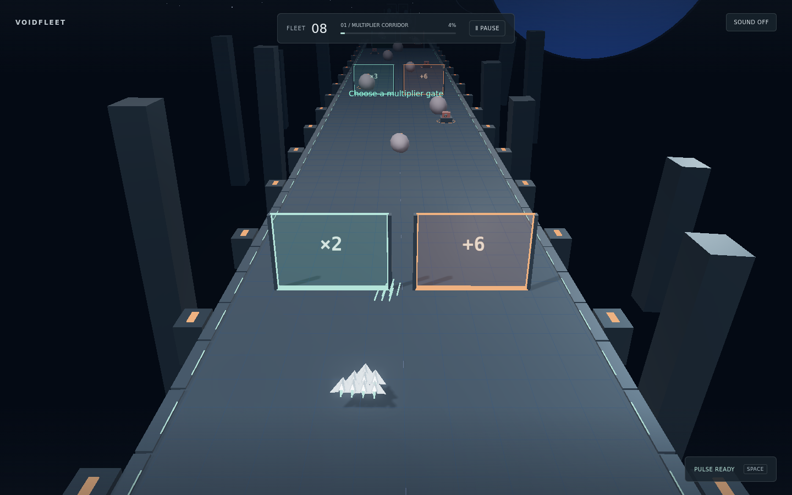

# VOIDFLEET — Space Fleet Multiplier

UTS EF234504 · Grafika Komputer. Kendalikan armada melalui multiplier gate, asteroid, dan turret untuk mengalahkan mothership.

| Anggota | NRP |
| --- | --- |
| Hajendra Herlambang | 5025241101 |

Main online: https://nakayesaa.github.io/ComputerGraphics/uts/play/



## Menjalankan

Node.js 20.19+. Jalankan dari folder `uts`:

```sh
npm install
npm run dev
```

Buka URL Vite. `npm run build` membuat produksi; `npm run preview` menjalankannya. `npm test` memeriksa aturan armada, formasi, dan sektor. `npm run deploy:build` memperbarui folder `play` untuk GitHub Pages.

## Gameplay dan kontrol

Mulai dengan 8 kapal, pilih gate untuk menambah/mengalikan armada (maksimal 60), hindari ancaman, lalu hancurkan mothership. Armada menembak otomatis; HP boss nol berarti menang, kapal nol berarti kalah. Tombol restart mengulang misi.

A/D atau panah dan mouse/drag: steering. Klik/tap target: Raycaster dan damage. Space/tombol pulse: bersihkan ancaman terdekat (cooldown 7 detik). P/Escape: pause/resume.

## Grafika dan implementasi

Three.js, GLTF lokal, parent–child armada/kapal/engine, PBR, empat light, shadow, fog, dan background prosedural. Animasi kapal, asteroid, turret, dan boss; VFX bloom, laser, particles, dan pulse. `src/main.js` memuat scene dan gameplay; `src/rules.js` memuat aturan armada.

## Pembagian kontribusi

Project dikerjakan individu. Hajendra Herlambang bertanggung jawab atas scene dan asset, gameplay dan interaksi, UI, VFX, pengujian, serta deployment; implementasi awal dibantu Codex.

## Challenge

Menjaga performa saat armada bertambah. Arena memakai 6 batch InstancedMesh, shadow 1024², pixel ratio maksimal 1.25, HUD 10 Hz, dan simulasi bertahap maksimal 1/60 detik. Collision memakai pusat formasi sebagai simplifikasi arcade.

## Asset credits

Kapal GLTF, objek prosedural, UI, VFX, dan audio sintetis dibuat untuk project ini; tidak ada model, tekstur, atau audio eksternal. [Three.js dan addons](https://github.com/mrdoob/three.js/blob/dev/LICENSE) serta [Vite](https://github.com/vitejs/vite/blob/main/LICENSE) berlisensi MIT.

Video demo: [Isi link]. Repository: https://github.com/nakayesaa/ComputerGraphics/tree/main/uts
