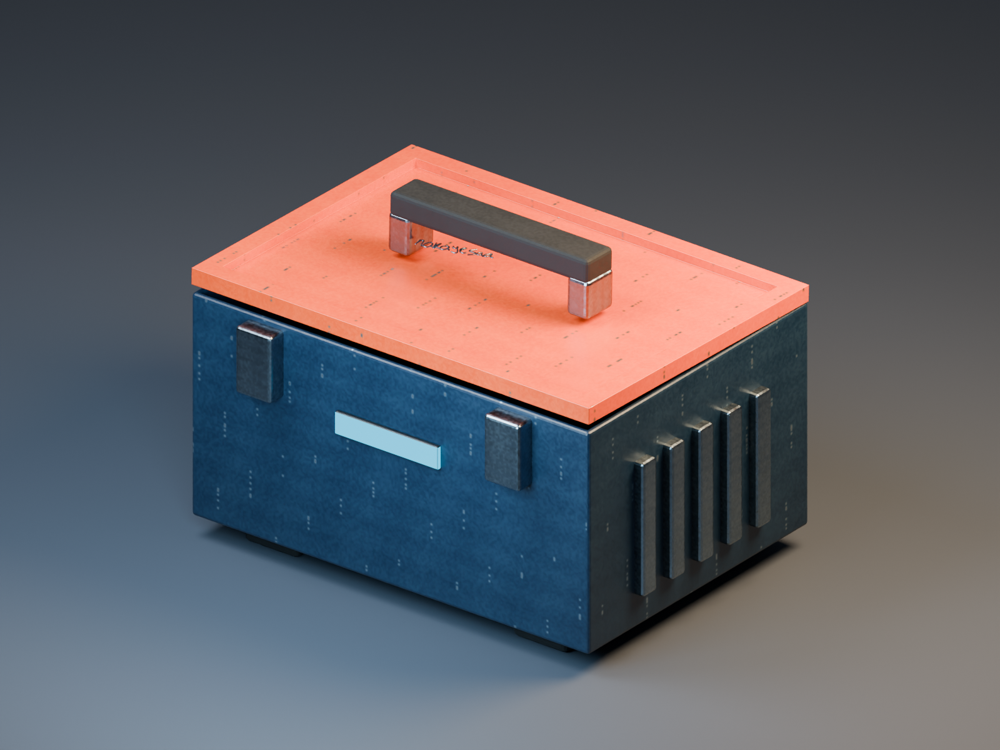
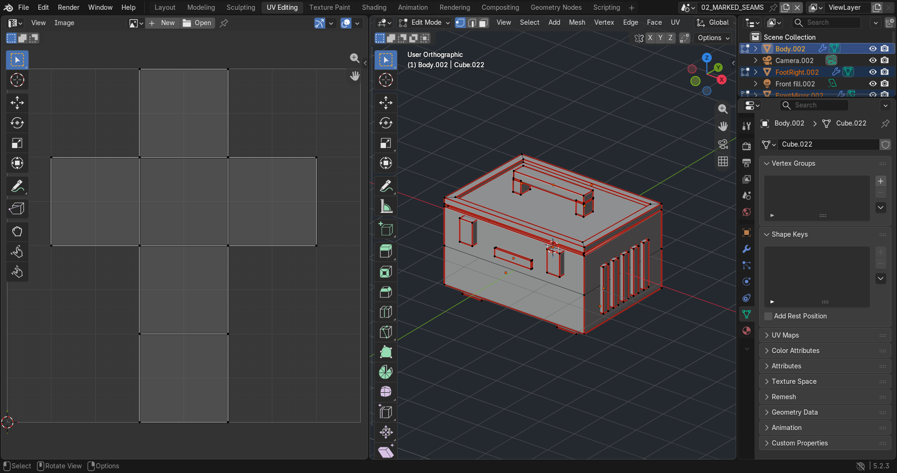
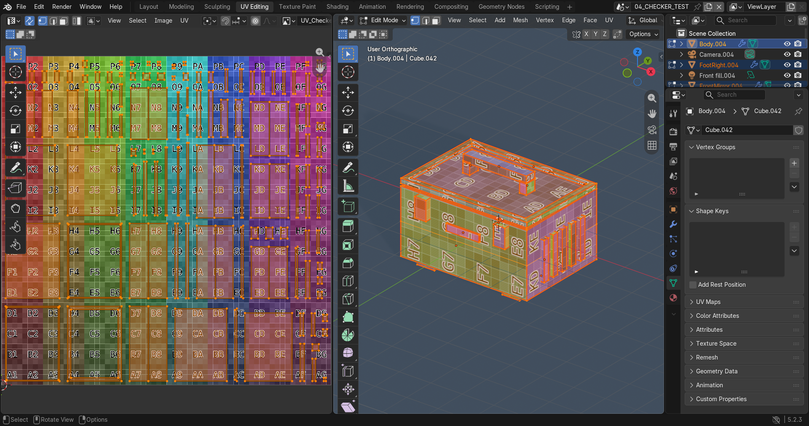
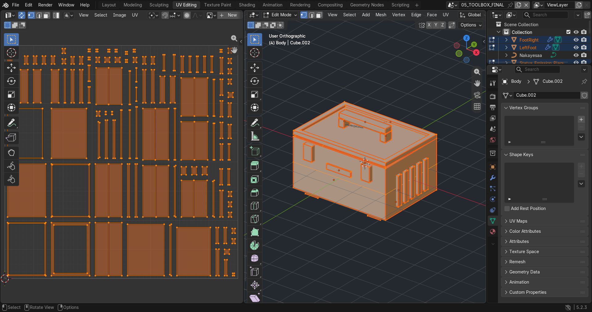
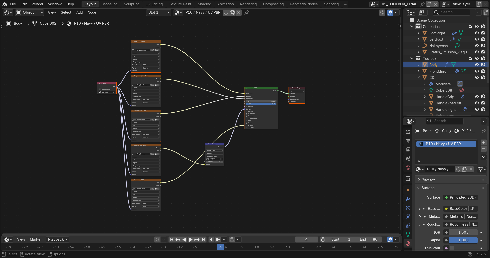
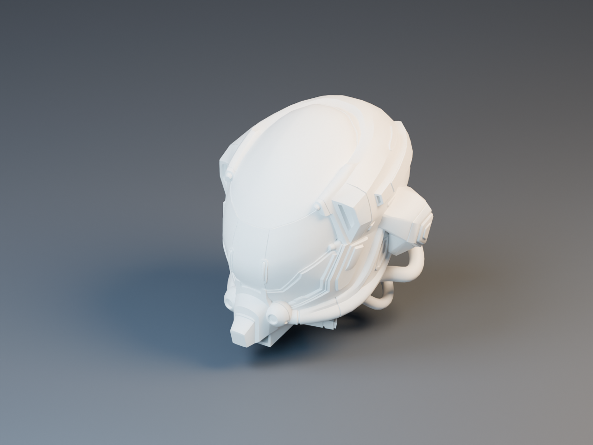
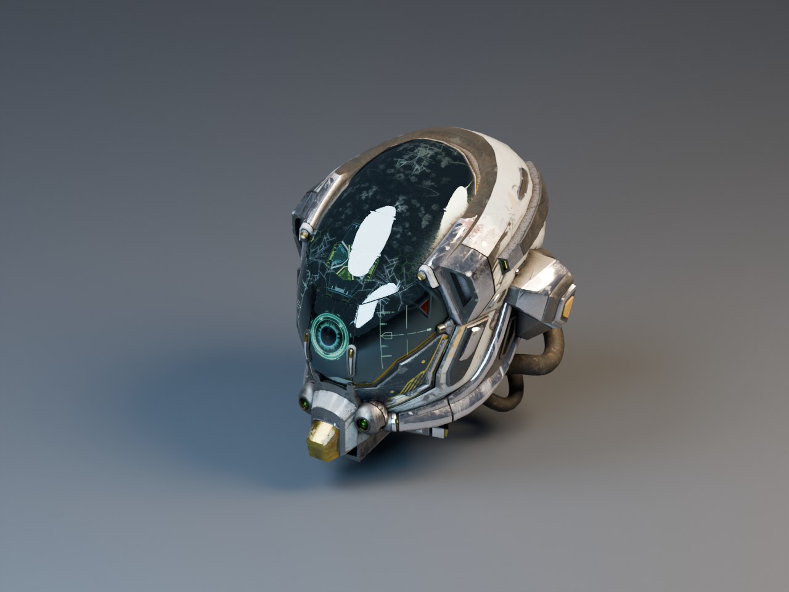
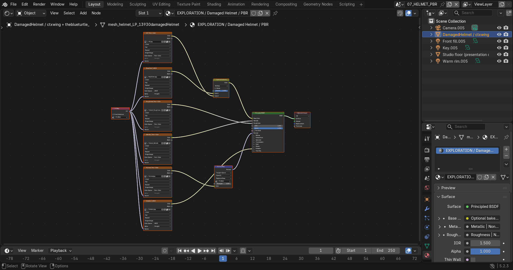

# Praktikum 10 — UV-Mapped PBR Toolbox

EF234504 · Grafika Komputer · Blender Materials, UV & Texturing

| Anggota | NRP |
|---|---|
| Hajendra Herlambang | 5025241101 |
| Muhammad Abdul Rafi | - |

Blender yang digunakan: **5.2.3 LTS**.

## Asset dan berkas

**Industrial Toolbox** merupakan pengembangan asset Praktikum 9: badan biru, tutup oranye, handle karet, pengunci depan, rib samping, kaki, dan tulisan Nakayesaa. Praktikum 10 menambahkan UV unik, tekstur cat berbutir, scuff metal, normal permukaan, roughness bervariasi, serta plaque indikator cyan.

- [P10_Kelompok_Toolbox.blend](P10_Kelompok_Toolbox.blend): asset utama, model eksplorasi, dan tujuh scene proses.
- [textures/toolbox/](textures/toolbox/): lima set PBR orisinal, masing-masing BaseColor, Roughness, Metallic, Normal, Emission; 1024 × 1024. Checker: 2048 × 2048.
- [textures/helmet/](textures/helmet/): map model eksplorasi pada resolusi asli 2048 × 2048, termasuk roughness dan metallic hasil pemisahan kanal.
- [screenshots/](screenshots/): screenshot antarmuka Blender dan render dokumentasi.
- [docs/validation.json](docs/validation.json): hasil pengukuran UV dan inventaris texture.
- [docs/DEMO.md](docs/DEMO.md): urutan penjelasan demo dan teks pengumpulan.
- [P10_Demo_Visual.mp4](P10_Demo_Visual.mp4): demo visual ber-caption dari screenshot Blender dan render, tanpa narasi suara.
- [scripts/](scripts/): proses yang dapat direproduksi menggunakan Python bawaan Blender.

## Geometry dan persiapan

Asset asli dibaca dari `../week9/P09_Kelompok_Toolbox.blend`, pada frame 4. Scale diterapkan sebelum unwrap; kaki yang awalnya berskala `(0.275, 1.25, 0.11)` menjadi `(1, 1, 1)`. Normal dihitung ulang ke arah luar. Mirror pengunci, pengulangan rib, dan Solidify direalisasikan sebelum UV sehingga permukaan hasil penggandaan memperoleh koordinat sendiri. Bevel dipertahankan sebagai modifier agar mudah disesuaikan untuk Praktikum 11. Tulisan berbentuk curve dipertahankan sebagai detail geometri, bukan bagian atlas mesh.

Scene `01_BEFORE_UV` adalah salinan kondisi awal dengan UV mesh dikosongkan untuk dokumentasi. Scene berikutnya menyimpan seam, unwrap awal, checker, dan hasil akhir; perubahan tahap dapat diperiksa langsung di Blender.

## Strategi seam dan fungsi UV island

Seam ditetapkan pada sudut panel, batas rim, tepi terbuka, dan pertemuan bidang dengan sudut lebih dari 35°. Penandaan edge dilakukan secara eksplisit lewat skrip `bpy` berdasarkan aturan panel tersebut, lalu memakai **Angle Based Unwrap** Blender; tidak memakai Smart UV Project. Tahap penandaan ini diotomatisasi, bukan rekaman klik manual. Seam tetap tersimpan dan dapat dipilih/diedit pada scene `02_MARKED_SEAMS`.

| Island utama | Fungsi dan lokasi potongan |
|---|---|
| Body | Memisahkan bidang depan, belakang, samping, dasar, dinding dalam, serta rim; sudut keras menjadi batas agar panel besar tidak terdistorsi. |
| Lid | Memisahkan bidang tutup, dinding bibir, dan bagian bawah; mempertahankan bidang luas untuk tekstur cat. |
| FrontMirror | Kedua pengunci mendapat UV terpisah setelah Mirror diterapkan; tidak ada penumpukan sisi kiri/kanan. |
| Sideribs | Setiap rib dan sisi sempitnya mendapat koordinat unik. |
| Handle posts | Bidang metal penyangga dipisahkan pada sudut dan underside. |
| HandleGrip dan kaki | Panel karet dipisahkan pada sudut agar ukuran checker konsisten. |
| Status plaque | Bidang muka dan sisi indikator menggunakan UV unik serta map emission berpola. |

## Unwrap, checker, distortion, texel density

Unwrap awal disimpan di `03_INITIAL_UNWRAP`. Masalah utama adalah perbedaan ukuran island antar-komponen: kaki, pengunci, dan badan memiliki dimensi berbeda tetapi hasil unwrap awal belum disetarakan skalanya secara global. Apply Scale, normal recalculation, seam per panel, dan **Average Islands Scale** menghindari perubahan ukuran checker yang tidak diinginkan. Bidang planar tidak memerlukan distorsi buatan untuk dokumentasi.

Pada scene `04_CHECKER_TEST`, material diganti dengan color grid. Kotak pada badan, tutup, pengunci, dan rib tampak konsisten; pada permukaan bevel kecil, interpolasi UV mengikuti modifier. Screenshot unwrap awal dan layout final dapat dibandingkan untuk melihat perubahan skala serta packing.

Packing memakai bounding box island yang boleh diputar untuk panel persegi panjang, dengan parameter margin ADD `0.015625`. Parameter packing bukan langsung ukuran gap final; gap diukur kembali setelah packing.

| Pemeriksaan pada mesh dasar | Hasil |
|---|---:|
| Jumlah island | 110 |
| Accidental overlap segitiga UV | 0 |
| Texel density minimum–maksimum @ 1K | 58.232–58.235 px/unit Blender |
| Median texel density | 58.233 px/unit Blender |
| Gap minimum antar-island @ 1K | 24.94 px |
| Jarak minimum dari batas atlas @ 1K | sekitar 12.47 px |
| Pemakaian luas UV | 39.55% |
| Rasio anisotropi median / maksimum | 1.000002 / 1.000068 |

Rasio anisotropi dihitung dari singular value transformasi segitiga permukaan ke UV; nilai 1 berarti tidak meregang secara tidak seragam. Density menggunakan luas UV terhadap luas permukaan, bukan perkiraan visual. Pemeriksaan overlap menggunakan separating-axis test pada segitiga, sehingga edge yang sekadar bersentuhan tidak dianggap overlap. Angka berlaku untuk mesh dasar yang di-unwrap, sebelum bevel evaluasi.

Packing mengutamakan margin dan tidak overlap; banyak panel sempit membuat utilisasi atlas masih 39.55%. Ini tradeoff yang diketahui. Untuk close-up ekstrem, atlas bisa dinaikkan menjadi 2K/4K atau ditata ulang lebih rapat. Pada tugas ini density disetarakan; tidak mengklaim challenge hero density atau UV optimization.

## Material PBR dan color space

Semua material utama memakai Principled BSDF dengan jalur UV eksplisit. Texture diletakkan di kolom kiri, konversi normal di tengah, Principled dan Output di kanan.

| Map | Color space | Hubungan node |
|---|---|---|
| BaseColor | sRGB | Image Texture → Base Color |
| Roughness | Non-Color | Image Texture → Roughness |
| Metallic | Non-Color | Image Texture → Metallic |
| Normal | Non-Color | Image Texture → **Normal Map** (Tangent) → Normal |
| Emission | sRGB | Image Texture → Emission Color; strength 2 hanya untuk status plaque |

**Non-metal:** cat Navy dan Orange memiliki metallic 0 pada lapisan cat; karet pada grip/kaki memiliki metallic 0 dan roughness tinggi. **Metal:** pengunci, rib, dan penyangga menggunakan metallic 1; scuff kecil pada cat membuka substrat metal melalui map Metallic. **Normal detail:** butiran cat, permukaan karet, dan guratan metal tangent-space; strength 0.28 agar tidak mengubah siluet. **Emission:** hanya plaque cyan yang menyala; set material lain memiliki map emission hitam dan strength 0.

Map toolbox dihasilkan deterministik melalui NumPy di dalam Blender, dengan seed 10; texture tersebut merupakan karya untuk proyek ini. Roughness memakai variasi butiran dan garis halus, bukan satu angka rata. Normal dihasilkan dari gradien height sintetis dan dinormalisasi sebelum disimpan menjadi RGB tangent-space.

## Eksplorasi PBR — Damaged Helmet

Model tambahan merupakan helm fiksi berpermukaan rusak dari [Khronos glTF Sample Assets — Damaged Helmet](https://github.com/KhronosGroup/glTF-Sample-Assets/tree/main/Models/DamagedHelmet). File GLB asli disimpan di [sources/helmet/](sources/helmet/) untuk memudahkan reproduksi.

**Atribusi:** © 2018 ctxwing, rebuild/conversion to glTF, CC BY 4.0; versi awal © 2016 theblueturtle_, CC BY-NC 4.0. [LICENSE asli](sources/helmet/LICENSE.md) dan [README sumber](sources/helmet/SOURCE_README.md) disertakan utuh. Model dipakai untuk pembelajaran nonkomersial; ketentuan nonkomersial versi awal tetap dihormati. Lisensi model ini terpisah dari asset toolbox.

Model diimpor memakai importer glTF Blender. Map yang tersedia pada GLB:

| Map tersedia | File proyek / perlakuan |
|---|---|
| Base Color | `textures/helmet/BaseColor.jpg`, sRGB |
| Metallic-Roughness | `MetallicRoughness.jpg`, Non-Color; kanal **G = Roughness**, **B = Metallic** |
| Roughness terpisah | `Helmet_Roughness.png`, diekstrak dari G, Non-Color |
| Metallic terpisah | `Helmet_Metallic.png`, diekstrak dari B, Non-Color |
| Normal | `Normal.jpg`, Non-Color → Normal Map → Principled Normal |
| Emission | `Emission.jpg`, sRGB → Emission Color, strength 1 |
| Ambient Occlusion | `AO.jpg`, Non-Color; Multiply terhadap Base Color |

Tidak ada texture detail yang dibuat ulang untuk helmet; pemisahan MR hanya memecah kanal data asli. AO digunakan sebagai tambahan occlusion bawaan asset. Node graph disusun ulang agar map terpisah mudah dijelaskan. Scene `06_HELMET_BEFORE` memakai material abu-abu tanpa texture; `07_HELMET_PBR` memakai seluruh map pada posisi, kamera, dan pencahayaan sama.

| Sebelum PBR | Sesudah PBR |
|---|---|
|  |  |

Warna cat, perbedaan kilap, bagian metal, kerusakan kecil, occlusion, dan emission tampil setelah PBR diterapkan. Bentuk mesh tidak berubah.

## Challenge yang dikerjakan

1. **Multi-material surface:** Navy, Orange, Steel, Rubber, dan Status memiliki set map serta respons Principled berbeda.
2. **Custom roughness variation:** roughness map berisi variasi butiran dan guratan, terlihat saat highlight melintas pada permukaan.
3. **Metal + painted surface:** cat dielectric dibedakan dari metal terekspos; map Metallic menyisakan scuff metal pada cat.
4. **Normal detail:** tangent normal memberi detail mikro tanpa menambah polygon siluet.

Map emission juga dibuat berpola dan dapat diperiksa pada `09_emission_mask.png`; challenge minimum sudah dipenuhi oleh empat poin di atas. Tidak ada intentional overlap.

## Kendala dan solusi

- **Scale kaki tidak seragam:** Apply Scale sebelum unwrap, lalu normal dihitung ulang.
- **Mirror/array dapat menggandakan UV:** modifier pengulangan diterapkan sebelum unwrap dan packing global.
- **Packing bentuk kompleks lambat:** gunakan packing AABB panel; periksa ulang overlap dan gap alih-alih menganggap parameter margin sebagai hasil akhir.
- **Path texture saat file dipindahkan:** texture memakai path relatif `//textures/...` dan seluruh image yang digunakan dipack dalam `.blend`.
- **Map roughness/metallic model luar tergabung:** ambil kanal G dan B dari MR asli, jangan menghubungkan seluruh RGB yang sama ke kedua input.
- **Texture hilang saat ekstraksi GLB:** map dibaca dari path absolut selama build, baru dibuat relatif setelah `.blend` disimpan pada lokasi final.
- **Ukuran repository:** toolbox menggunakan 1K dan file Blender sekitar 34 MB, di bawah batas file GitHub biasa. Berkas backup `.blend1` tidak perlu dikumpulkan.

## Dokumentasi dan pemeriksaan akhir

Screenshot antarmuka Blender diambil oleh `scripts/capture.py`; file dengan akhiran `_render` serta gambar final/helmet adalah hasil render Blender. Scene proses disimpan dalam `.blend`, sehingga screenshot dapat diverifikasi dengan membuka scene terkait. Proses utama diotomatisasi menggunakan Python Blender; dokumentasi ini tidak mengklaim proses klik manual.

- [Sebelum UV](screenshots/01_before_uv.png)
- [Marked seams](screenshots/02_marked_seams.png)
- [Initial unwrap](screenshots/03_initial_unwrap.png)
- [Checker test](screenshots/04_checker_test.png)
- [Final UV layout](screenshots/05_final_uv_layout.png)
- [Principled graph](screenshots/06_principled_graph.png)
- [Base Color](screenshots/07_base_color.png), [Roughness](screenshots/07_roughness.png), [Metallic](screenshots/07_metallic.png)
- [Normal Map](screenshots/08_normal_map.png)
- [Emission mask](screenshots/09_emission_mask.png)
- [Final material](screenshots/14_final_material_in_blender.png)

Asset siap dilanjutkan untuk lighting, camera, dan rendering Praktikum 11. Scene final sudah memiliki studio dasar sebagai preview; objek floor/lamp/camera dibedakan namanya dari asset. Buka `05_TOOLBOX_FINAL` untuk asset utama atau `07_HELMET_PBR` untuk eksplorasi.

**Uji pemindahan nyata:** hanya `.blend` disalin ke folder sementara tanpa `textures/`, kemudian dibuka ulang di Blender. Semua 37 image tetap memiliki buffer pixel yang terbaca. Hasilnya tersimpan pada [docs/portability.json](docs/portability.json); pengujian dapat diulang dengan `scripts/portability.py`.

Untuk reproduksi: jalankan `blender --background --python scripts/build.py`, lalu `blender --background --python scripts/validate.py`. Build memerlukan file week 9 pada folder tetangga; file `.blend` hasilnya dapat dibuka mandiri karena texture sudah dipack. Untuk screenshot antarmuka gunakan Blender foreground: `blender --python scripts/capture.py`.
