# Praktikum 10 — Blender Materials, UV & Texturing

Hajendra Herlambang — 5025241101

Muhammad Abdul Rafi — NRP: -

Praktikum ini mengembangkan toolbox Praktikum 9 dengan penentuan seam, UV unwrap, checker test, penyamaan texel density, dan packing tanpa overlap. Material PBR menggunakan Principled BSDF dengan Base Color, Roughness, Metallic, Normal Map, dan Emission serta color space yang sesuai. Challenge meliputi multi-material, variasi roughness, metal dan cat, serta normal detail. Eksplorasi PBR memakai [Damaged Helmet dari Khronos](https://github.com/KhronosGroup/glTF-Sample-Assets/tree/main/Models/DamagedHelmet) dengan [atribusi dan lisensi terlampir](textures/helmet/LICENSE.md). File Blender, texture, dan screenshot proses tersedia di folder ini.

Untuk demo gabungan, buka [file Blender](P10_Kelompok_Toolbox.blend) dan pilih scene `00_DEMO_COMBINED`. Scene ini sudah aktif saat file dibuka; tekan F12 untuk render ulang.

**1. Asset sebelum UV**

Toolbox Praktikum 9 digunakan sebagai dasar. Geometry, scale, dan normal diperiksa sebelum unwrap.

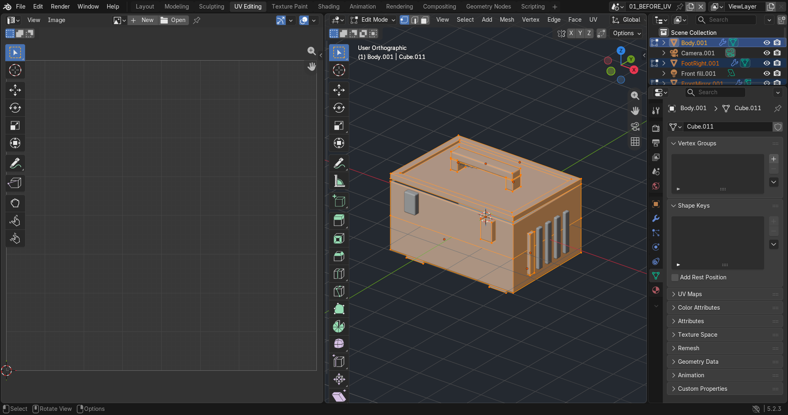

**2. Penentuan seam**

Seam ditempatkan pada sudut panel, rim, dan bagian bawah untuk memisahkan bidang yang akan dibentangkan.

**3. Unwrap awal**

Mesh dibentangkan menjadi UV island untuk badan, tutup, pengunci, handle, rib, dan kaki.

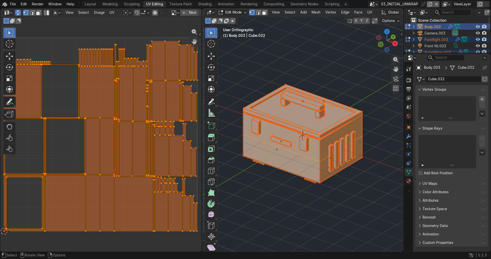

**4. Checker test**

Checker dipakai untuk melihat stretching dan perbedaan ukuran tekstur. Skala island disetarakan agar ukuran checker konsisten.

**5. UV layout akhir**

Island dipacking tanpa overlap. Texel density sekitar 58,23 px/unit dan jarak minimum antar-island sekitar 24,94 px pada texture 1K.

**6. Node material PBR**

Base Color, Roughness, Metallic, Normal, dan Emission dihubungkan ke Principled BSDF. Base Color memakai sRGB; Roughness, Metallic, dan Normal memakai Non-Color.

**7. Base Color**

Map warna memberi warna cat dan scuff pada permukaan toolbox.

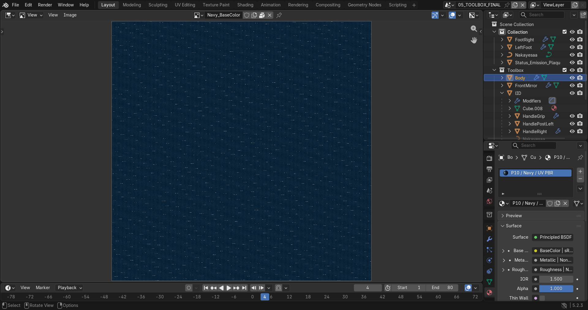

**8. Roughness**

Variasi roughness mengatur perbedaan kilap pada permukaan cat, metal, dan karet.

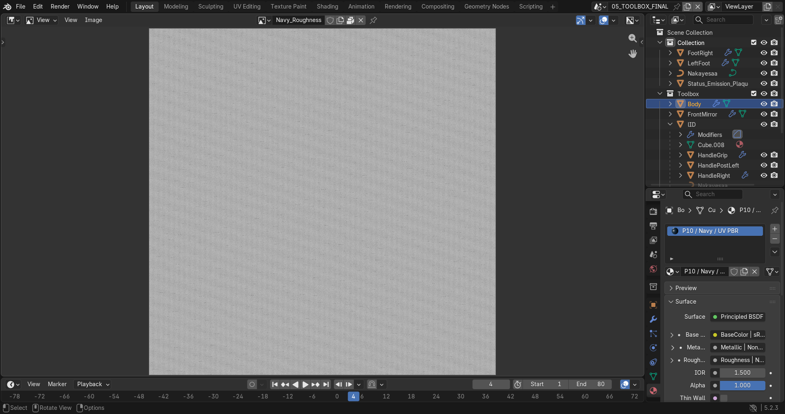

**9. Metallic**

Map Metallic membedakan cat dan karet sebagai non-metal dari bagian metal yang terekspos.

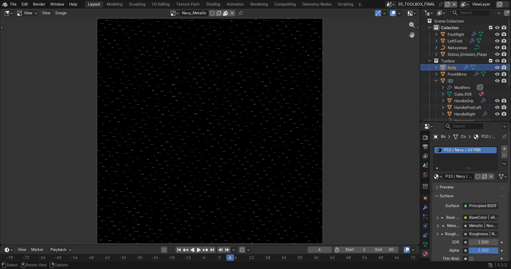

**10. Normal Map**

Texture normal dihubungkan melalui Normal Map node untuk menambah detail permukaan tanpa mengubah siluet.

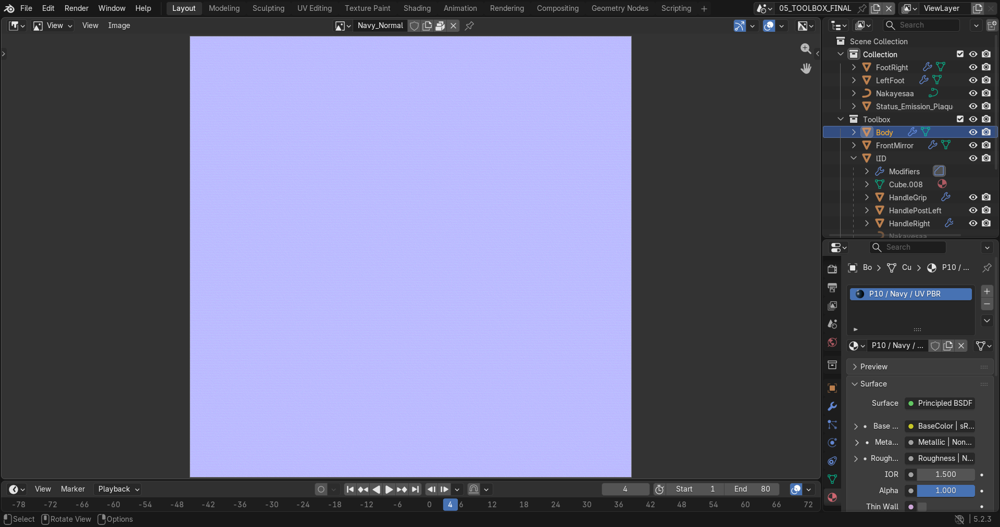

**11. Emission**

Mask emission memberi aksen cyan pada indikator depan toolbox.

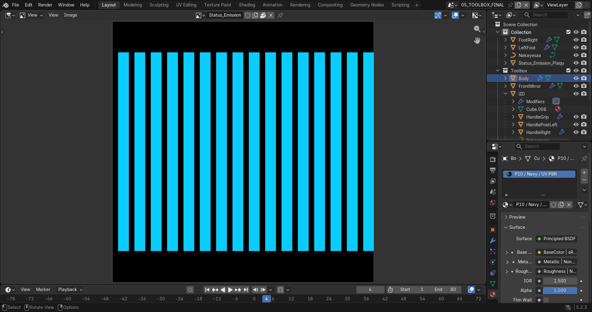

**12. Hasil akhir toolbox**

Material cat, metal, karet, dan emission diperiksa pada hasil render. Challenge yang dikerjakan adalah multi-material, variasi roughness, metal dan cat, serta normal detail. Texture dipack di dalam file Blender agar tetap terbaca saat dipindahkan.

**13. Eksplorasi PBR — sebelum material**

Damaged Helmet ditampilkan dengan material polos sebagai pembanding.

**14. Eksplorasi PBR — node material**

Map Base Color, Roughness, Metallic, Normal, Emission, dan AO dihubungkan ke material. Roughness diambil dari kanal G dan Metallic dari kanal B pada map gabungan asli.

**15. Eksplorasi PBR — hasil akhir**

Setelah map diterapkan, warna, kilap metal, detail kerusakan, dan emission terlihat pada model dengan geometry yang sama.

**16. Scene gabungan untuk demo**

Toolbox dan helmet digabung dalam scene `00_DEMO_COMBINED`, dengan toolbox di kiri dan helmet di atas pedestal di kanan. Ground dan alas display menyatukan komposisi. Scene ini langsung aktif saat [file Blender](P10_Kelompok_Toolbox.blend) dibuka.

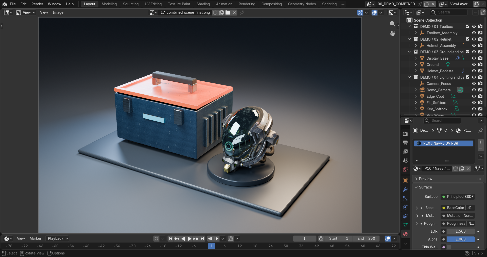

**17. Lighting**

Empat Area Light digunakan sebagai key, fill, rim hangat, dan edge dingin untuk memperjelas bentuk, bayangan, serta perbedaan material kedua model.

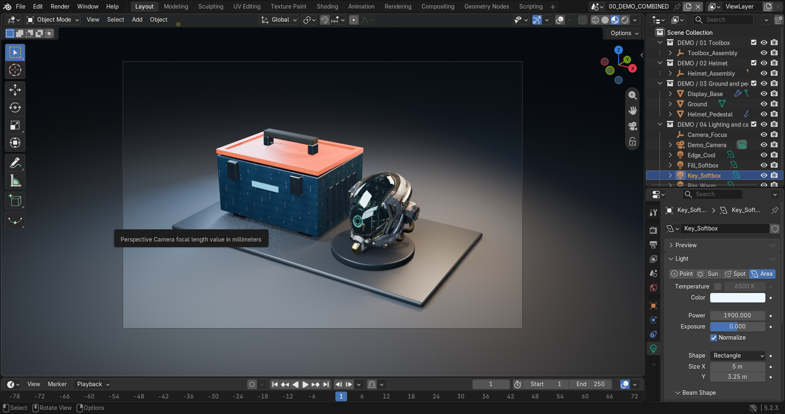

**18. Camera**

Kamera perspektif 55 mm diarahkan ke tengah kedua model. Aperture f/10 menjaga keduanya tetap jelas dalam komposisi.

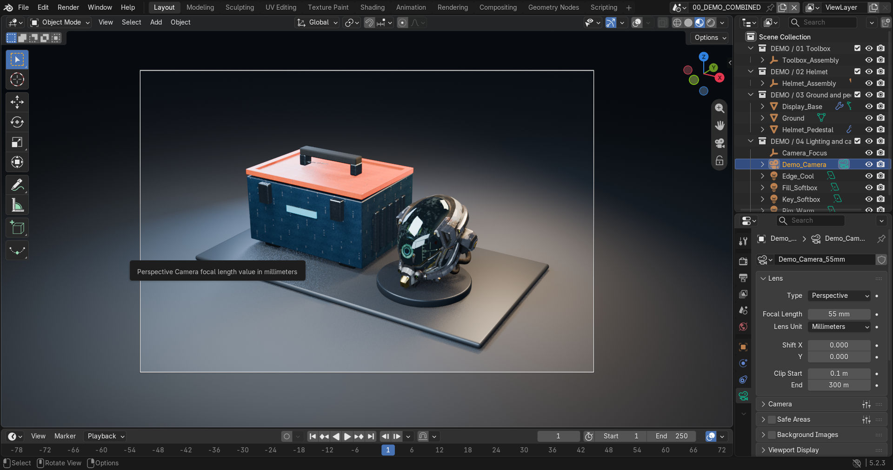

**19. Render gabungan**

Hasil akhir dirender menggunakan Cycles, 128 samples, dan denoising pada resolusi 1920 × 1280. Kedua model menggunakan lighting dan kamera yang sama, dengan seluruh texture tetap dipack di file Blender. Tekan F12 untuk render ulang.

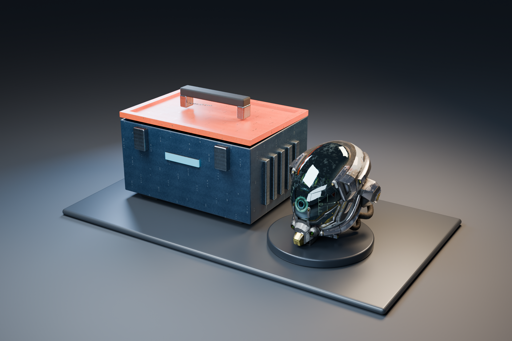
