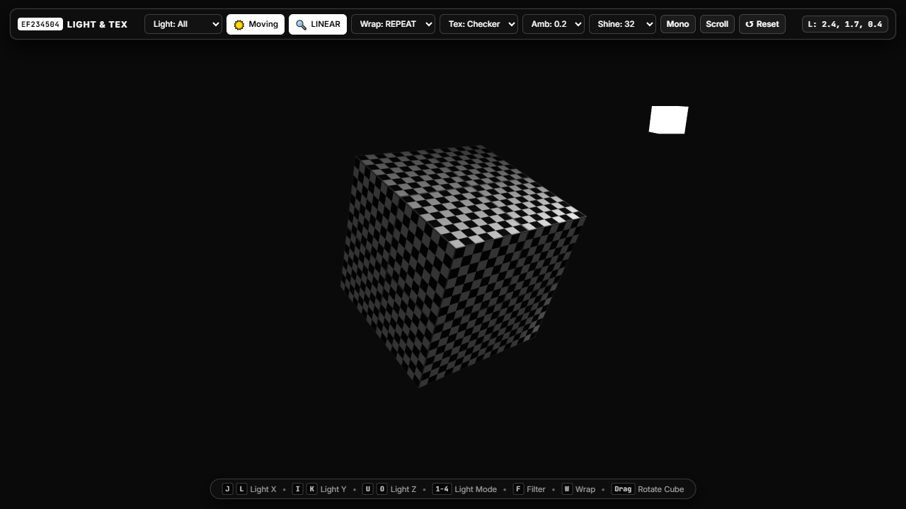

# Praktikum 05 — WebGL Textured & Lit Object Playground

- Nama: Hajendra Herlambang
- NRP: 5025241101
- Mata kuliah: EF234504 · Grafika Komputer
- Aplikasi: https://nakayesaa.github.io/ComputerGraphics/week5/
- Repository: https://github.com/nakayesaa/ComputerGraphics/tree/main/week5

## Menjalankan

Tanpa dependency dan build step. Dari root repository:

```sh
python3 -m http.server 8000
```

Buka http://localhost:8000/week5/ dengan browser yang mendukung WebGL2. Gunakan HTTP agar modul, shader, dan texture dapat dimuat.

## Implementasi

Cube melanjutkan konsep model/view/projection Week 4. Terdapat 36 vertex dengan position, normal, dan UV buffer terpisah; normal per sisi mempertahankan sudut tajam. Cube berputar dengan delta time, perspective mengikuti ukuran canvas, depth test selalu aktif, dan color/depth buffer dibersihkan setiap frame.

Vertex shader menghitung posisi world dan inverse-transpose normal matrix. Fragment shader mengambil warna dari `texture()` dan menghitung ambient, Lambert diffuse, serta Phong specular. Posisi light, posisi fragmen, normal, dan kamera berada dalam world space. Specular memakai `normalize(cameraPosition - fragmentPosition)` dan `reflect(-L, N)`, sehingga drag kamera mengubah highlight. Specular hanya aktif pada sisi yang menerima diffuse.

Parameter awal: ambient **0.2**, shininess **32**, diffuse strength **0.75**, specular strength **0.8**, light putih pada **(2.5, 2.5, 3)**. Kamera dapat diorbit dan di-zoom. Mode perbandingan: Ambient Only, Diffuse Only, Specular Only, Ambient + Diffuse, All Components.

Texture lokal `assets/checker.png` dan `assets/grid.png` berukuran 64×64, dibuat sendiri secara prosedural tanpa aset pihak ketiga. Seluruh sisi memakai UV 0–1, dikalikan UV scale awal **2**, sehingga wrapping dapat langsung diamati. LINEAR/NEAREST diterapkan pada MIN dan MAG; wrapping diterapkan pada S dan T. Tidak memakai mipmap agar perbandingan kedua filter langsung terlihat.

## Kontrol

| Input | Fungsi |
| --- | --- |
| J / L | Light X − / + |
| K / I | Light Y − / + |
| O / U | Light Z − / + |
| 1 / 2 / 3 | Ambient / Diffuse / Specular Only |
| 4 / 5 | Ambient + Diffuse / All Components |
| F | LINEAR ↔ NEAREST |
| W | REPEAT → CLAMP_TO_EDGE → MIRRORED_REPEAT |
| M | Moving light otomatis |
| T | Ganti texture |
| Space | Jeda / lanjut rotasi cube |
| R | Reset semua parameter dan kamera |
| Drag canvas / scroll | Orbit kamera / zoom |

Panel menyediakan mode, preset ambient dan shininess, UV scale, texture, toggle challenge, dan tombol gerak light untuk mouse/touch. HUD menampilkan mode, light XYZ, ambient, shininess, filter, wrapping, serta challenge aktif. Shortcut tidak mengambil alih input saat kontrol form sedang fokus; klik canvas untuk kembali menggunakan shortcut. Gerak manual light mematikan moving light otomatis agar kedua kontrol tidak bertabrakan. Posisi light dibatasi −5 sampai 5 per sumbu.

## Challenge

1. **Moving light otomatis:** orbit light pada XZ, tinggi 2.5; dapat ditoggle lewat M/panel.
2. **Multiple textures:** dua texture lokal dapat diganti lewat T/dropdown.
3. **Light position marker:** cube putih kecil tanpa lighting menunjukkan lokasi sumber cahaya, mengikuti light manual maupun otomatis, dengan depth test tetap aktif.

## Eksperimen dan pengamatan

Jeda rotasi dengan Space untuk membandingkan parameter pada orientasi yang sama. Gunakan All Components kecuali saat membandingkan komponen.

| Eksperimen | Pengamatan |
| --- | --- |
| Ambient 0 / 0.2 / 0.5 | 0 menghilangkan pencahayaan dasar; sisi tanpa diffuse gelap. 0.2 menjaga detail texture pada sisi gelap. 0.5 membuat seluruh sisi lebih terang dan mengurangi kontras shading. |
| Shininess 4 / 32 / 128 | 4 menghasilkan highlight lebar, 32 lebih terpusat, 128 sangat kecil dan tajam. Orbit kamera untuk mencari highlight; sisi yang tidak menghadap pantulan bisa sepenuhnya gelap pada Specular Only. |
| NEAREST / LINEAR | NEAREST menunjukkan texel bertepi tajam dan lebih bergerigi pada sisi miring. LINEAR melembutkan peralihan antartexel. Zoom untuk melihat perbedaannya. |
| Repeat / Clamp / Mirror | Pada UV scale 2, Repeat mengulang pola; Clamp memperpanjang warna tepi setelah UV 1; Mirror membalik pola setiap interval. Texture Grid membuat sambungan mirror lebih mudah diamati. |
| Ambient Only | Texture mendapat intensitas seragam, tanpa arah cahaya atau highlight. |
| Diffuse Only | Terang sisi mengikuti normal dan arah menuju light; sisi membelakangi light gelap. |
| Specular Only | Hanya highlight putih yang terlihat; berubah saat kamera/light bergerak. |
| Ambient + Diffuse / All | All menambahkan highlight ke texture dan shading yang sudah dibentuk ambient + diffuse. |

## Pemeriksaan

Jalankan pemeriksaan buffer, normal, UV, dan matematika tanpa dependency:

```sh
node --experimental-default-type=module week5/check.mjs
```

Browser diuji pada Chromium dengan WebGL2: shader compile/link, lima mode lighting, input XYZ, preset ambient/shininess, perubahan visual filtering/wrapping, pergantian texture, moving light, marker, orbit kamera, reset, dan layout mobile. Console dan `gl.getError()` diperiksa. Screenshot aplikasi ada di bawah.

## Kendala

- UV 0–1 saja membuat wrapping sulit dibedakan: UV scale disediakan dengan default 2.
- Highlight specular bisa tidak terlihat jika pantulan menjauhi kamera: orbit kamera dan preset shininess 4 membantu observasi.
- Membuka lewat `file://` tidak mendukung pemuatan modul/shader dengan benar: gunakan server HTTP.
- Bila WebGL2 atau aset gagal dimuat, pesan kesalahan ditampilkan pada viewport.

## Screenshot dan pengumpulan



Video demo belum direkam. Tambahkan tautan video sebelum mengumpulkan ke Classroom; tunjukkan texture, kelima mode, light XYZ, orbit kamera, preset eksperimen, filtering, wrapping, dan ketiga challenge. Identitas di atas mengikuti README Week 4; bila dikerjakan berkelompok, lengkapi nama dan NRP anggota sebenarnya.
