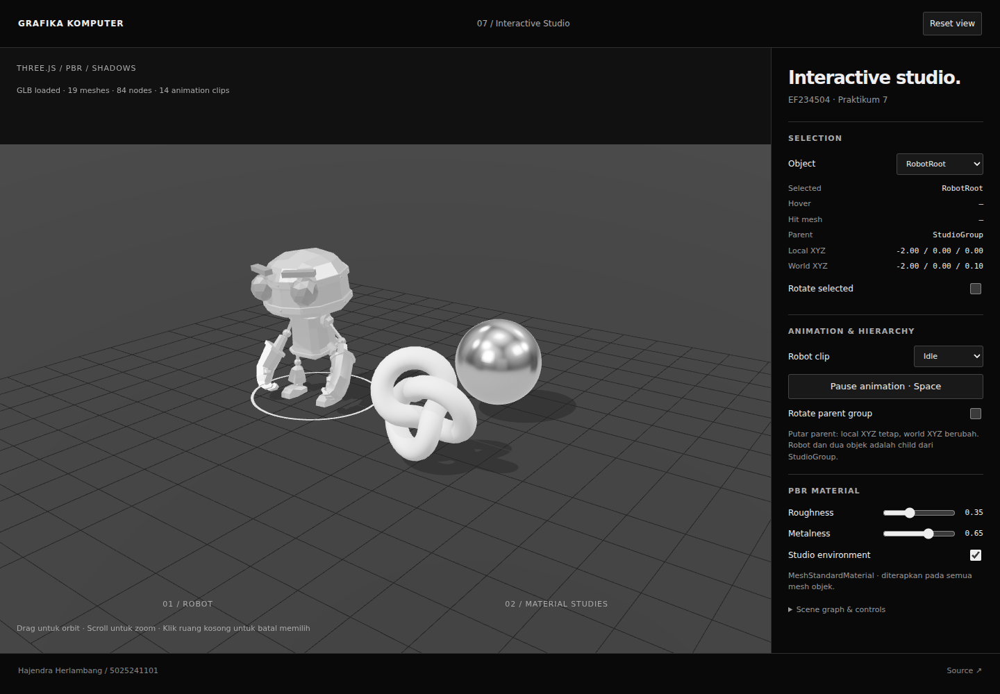

# Praktikum 07 — Interactive Studio

Prototype studio 3D untuk persiapan project UTS. Robot GLB beranimasi dan dua objek material dapat di-hover, dipilih, diputar, serta diubah parameter PBR-nya. Tampilan monokrom mengikuti Week 6.

## Identitas

- Nama: Hajendra Herlambang
- NRP: 5025241101
- Mata kuliah: EF234504 · Grafika Komputer
- App: https://nakayesaa.github.io/ComputerGraphics/week7/
- Repository: https://github.com/nakayesaa/ComputerGraphics/tree/main/week7

Identitas mengikuti praktikum sebelumnya. Jika pengumpulan berkelompok, tambahkan nama dan NRP anggota sebenarnya.

## Menjalankan

Memerlukan Node.js 18+ dan npm. Dari root repository:

```sh
cd week7
npm install
npm run dev
```

Buka URL yang ditampilkan Vite (default http://localhost:5173). `npm run check` memeriksa GLB, skinning, animation clips, AnimationMixer, dan transform hierarchy. `npm run build` menghasilkan `dist/`; `npm run preview` menguji hasil build.

Vite menggunakan `src/index.html` sebagai entry development. `index.html`, `assets/`, dan `models/` pada root Week 7 adalah hasil build yang disimpan untuk GitHub Pages. Source asli tersedia di `src/`, aset asli di `public/`. Tidak ada dependency CDN saat aplikasi berjalan. `node_modules/` dan `dist/` diabaikan Git.

Untuk memperbarui versi statis sesudah mengubah source:

```sh
npm run build
cp dist/index.html index.html
cp -r dist/assets dist/models .
```

## Struktur scene graph

```text
Scene
├ HemisphereLight
├ DirectionalLight (key, castShadow)
├ DirectionalLight (fill)
├ Ground (receiveShadow)
├ GridHelper
├ SelectionRing
└ StudioGroup (THREE.Group)
  ├ RobotRoot (THREE.Group), local (-2, 0, 0)
  │ └ RobotExpressive (GLB scene)
  │   └ hierarchy asli: nodes / bones / SkinnedMesh
  ├ Chrome sphere, local (2, 1.2, -1.5)
  └ Matte knot, local (2, 1.25, 1.7)
```

Transform child relatif terhadap parent. Aktifkan **Rotate parent group** dengan sebuah objek terpilih: Local XYZ tetap, World XYZ berubah. World position dihitung melalui `getWorldPosition()` setelah world matrices diperbarui. Ring selection berada di Scene dan mengikuti posisi world objek, sehingga tidak terlepas saat parent berputar. Matikan rotasi parent untuk pemeriksaan pada posisi tetap.

## Model GLB dan sumber

- `public/models/RobotExpressive.glb`: RobotExpressive oleh **Tomás Laulhé / Quaternius**, dimodifikasi **Don McCurdy**. Lisensi **CC0 1.0**.
- Sumber versi yang dipakai: [Three.js r170 RobotExpressive](https://github.com/mrdoob/three.js/tree/r170/examples/models/gltf/RobotExpressive).
- Kredit/lisensi upstream disimpan di `public/models/ASSET_LICENSE.md` dan salinan deployment `models/ASSET_LICENSE.md`.
- Di-load asynchronous memakai `GLTFLoader.loadAsync()`. Status loading/berhasil/gagal terlihat di viewport. `traverse()` memeriksa semua node, menghitung mesh/node, mengaktifkan `castShadow` dan `receiveShadow`, serta mengganti material dengan versi PBR monokrom.
- Hierarchy bones, skinning, dan morph target tetap dipertahankan. Model dinormalisasi menjadi tinggi 3.8 unit dan kaki ditempatkan pada ground.

## Animation clips

Seluruh clip dari GLB dimasukkan ke dropdown, dengan **Idle** sebagai default. Pilih misalnya **Walking**, **Running**, **Dance**, atau **Wave** untuk membandingkan gerakan. `AnimationMixer` terikat ke imported scene dan diperbarui lewat `mixer.update(delta)`. Pergantian clip menggunakan crossfade 0.25 detik. Clip diulang untuk observasi, termasuk clip gesture yang aslinya singkat. Terdapat 14 clip: Dance, Death, Idle, Jump, No, Punch, Running, Sitting, Standing, ThumbsUp, Walking, WalkJump, Wave, dan Yes. Jumlah clip ditampilkan di HUD dan diperiksa oleh `npm run check`.

**Pause animation** menghentikan mixer, rotasi parent, dan rotasi selection; orbit kamera dan interaksi tetap bekerja. Semua animasi menggunakan delta time dengan batas 0.05 detik agar tab yang lama tidak aktif tidak meloncat.

## PBR dan environment

Seluruh objek utama memakai `MeshStandardMaterial`:

| Objek | Roughness | Metalness |
| --- | --- | --- |
| Robot | 0.35 | 0.65 |
| Chrome sphere | 0.16 | 0.95 |
| Matte knot | 0.75 | 0.10 |
| Ground | 0.90 | 0.00 |

Slider mengubah seluruh material pada objek terpilih. Material tiap mesh robot dibuat terpisah sehingga hover dan edit tidak bocor ke objek lain. Warna asli robot dikonversi menjadi grayscale; highlight, lampu, environment, dan antarmuka juga monokrom.

`RoomEnvironment` bawaan Three.js diproses melalui `PMREMGenerator` lalu dipasang sebagai `scene.environment`. Ini menyediakan pantulan studio pada material metalness tinggi tanpa unduhan HDR. Toggle environment hanya mengubah environment map; key light dan fill tetap aktif agar perbandingan dapat diamati. Renderer memakai ACES filmic tone mapping, PCF soft shadows, dan pixel ratio maksimal 2.

## Interaksi dan visual feedback

- Drag: orbit kamera. Scroll/pinch: zoom.
- Hover: emissive putih intensitas 0.22 serta cursor pointer.
- Klik: selection tersimpan, ring putih di ground dan emissive 0.09; panel menampilkan nama, parent, local/world XYZ, material, dan child mesh yang terkena ray.
- Klik ruang kosong / **Esc**: clear selection. Dropdown menyediakan alternatif selection pada layar sentuh.
- Raycaster mengonversi pointer dari bounding rectangle canvas ke NDC; `intersectObjects(objects, true)` mendeteksi mesh sampai child GLB. Hit mesh ditelusuri ke ancestor selectable sehingga seluruh robot dipilih sebagai satu objek.
- Drag lebih dari 5 piksel tidak dianggap klik selection.
- **Space** / tombol: pause/play. Shortcut tidak mengambil alih kontrol form.
- **Reset view**: mengembalikan kamera dan target orbit; parameter scene tetap sesuai pilihan pengguna.

## Challenge yang dikerjakan

1. **Multiple animation clips**: dropdown semua clip GLB dan crossfade.
2. **Information panel**: selected/hover/hit mesh, parent, local/world position, parameter PBR.
3. **Hover emissive**: highlight sementara, kembali ke state selection saat pointer pergi.
4. **Selection rotation**: checkbox memutar objek terpilih memakai delta.
5. **Environment toggle**: bandingkan material dengan/tanpa environment map.

## Pemeriksaan dan catatan debugging

- `npm install`, `npm run check`, dan `npm run build` harus berhasil.
- Scene/renderer/camera, shadow, ground, animation loop, dan resize tersedia. ResizeObserver mengikuti ukuran canvas dan memperbarui aspect kamera; layout menjadi vertikal pada layar kecil.
- Periksa hover/click pada kepala dan tubuh robot: hit mesh dapat berbeda tetapi selection tetap RobotRoot.
- Periksa local/world dengan parent rotation; gunakan Pause untuk membaca nilai yang tetap.
- Ubah roughness/metalness lalu toggle environment untuk melihat perubahan pantulan.
- Periksa clip dan Pause/Play, rotasi selection, clear selection, serta orbit drag yang tidak memilih objek.
- Loader asynchronous tidak menghentikan render: sphere/knot tetap dapat dipakai ketika robot belum selesai dimuat. Jika file gagal dimuat, viewport menampilkan pesan gagal; reload setelah memperbaiki koneksi/path.
- Asset URL relatif mengikuti Vite base agar berfungsi di subfolder GitHub Pages `/week7/`.
- Model GLB bisa mempunyai nested mesh dan material bersama; ancestor selection dan material independen menghindari pemilihan child yang keliru atau highlight bocor.
- Console dan error WebGL diperiksa pada penggunaan normal di Chromium. Pengujian otomatis browser mencakup loading GLB, raycast, hover, selection, clip, PBR, hierarchy, environment, pause, kamera, dan layout mobile.

## Screenshot dan pengumpulan



Video demo belum direkam. Tambahkan tautan video sebelum pengumpulan Classroom. Tunjukkan GLB, ganti clip, parent hierarchy/local/world, material PBR, hover/click, rotasi selection, environment, serta responsive layout. Cantumkan identitas dan link repository di atas.
