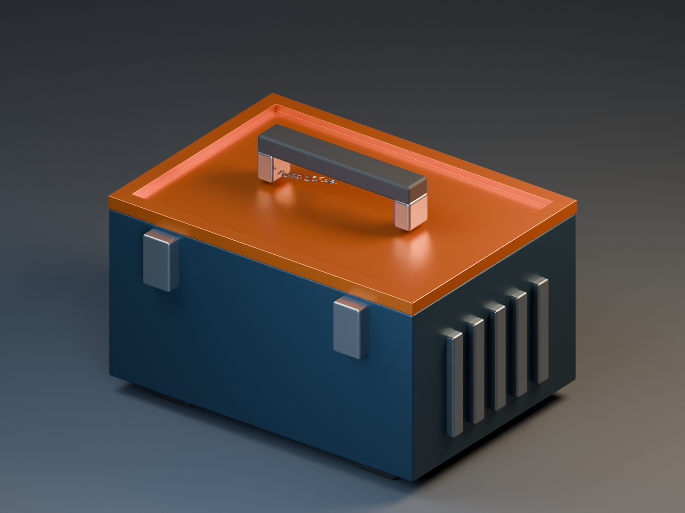
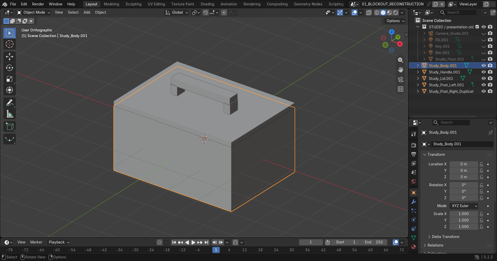
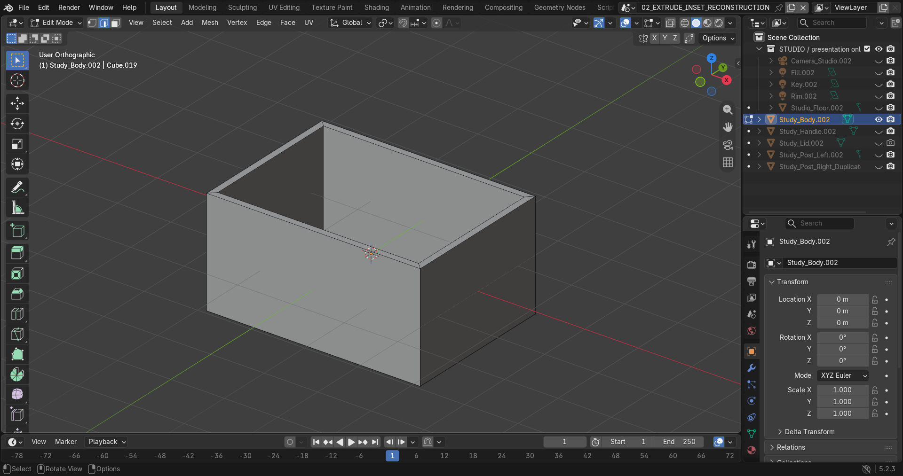
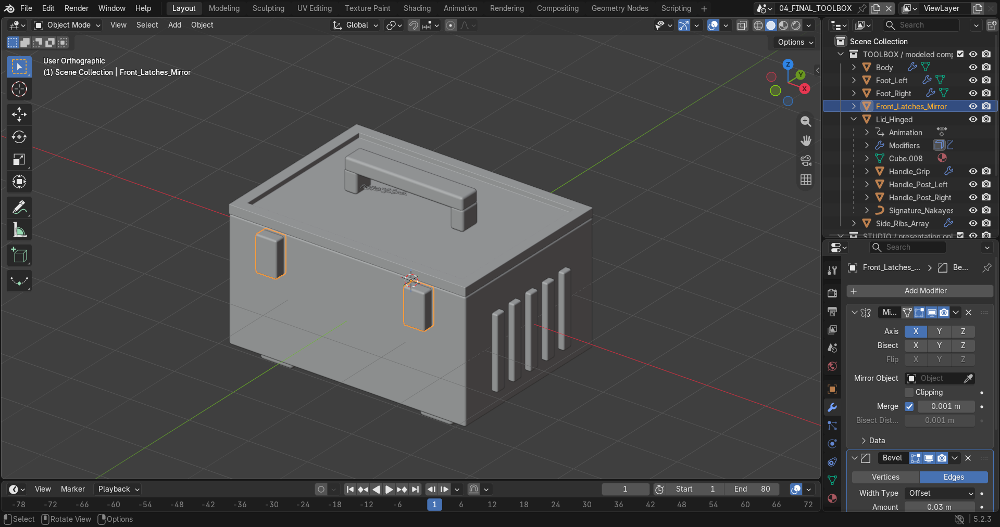
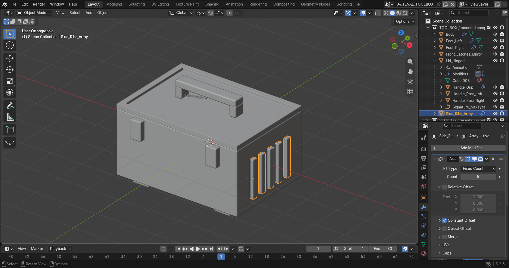
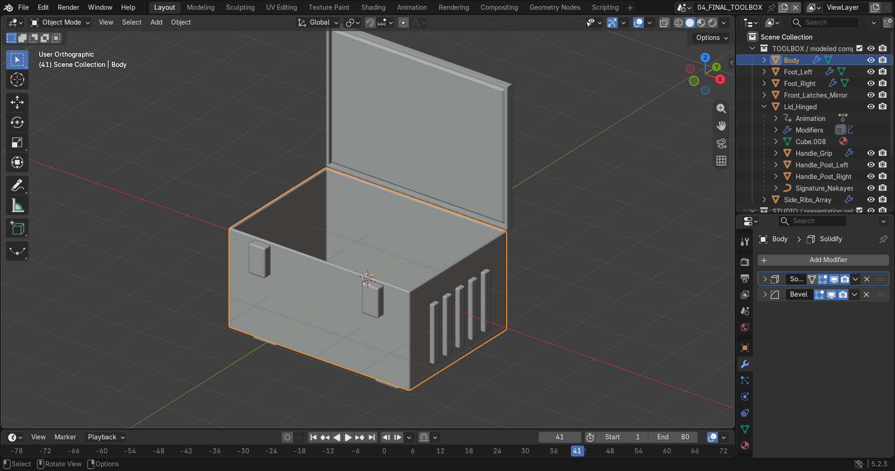
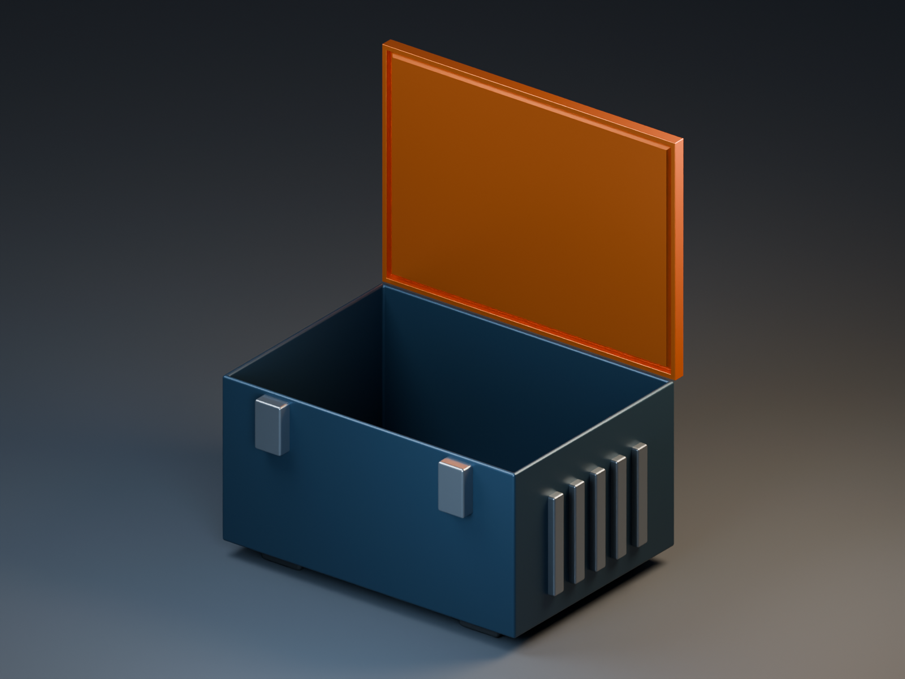
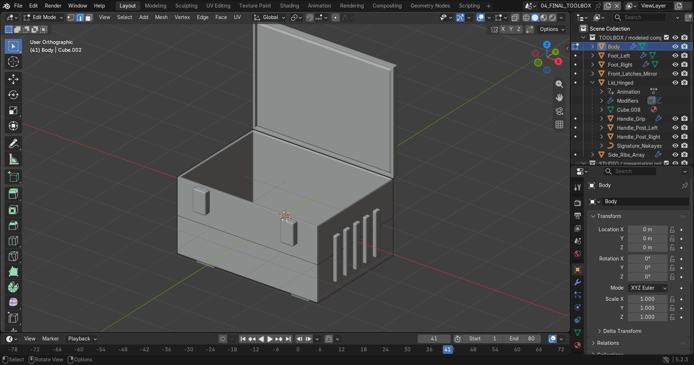
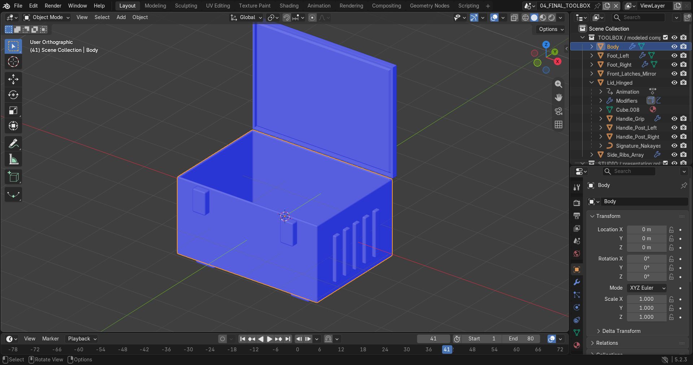

# Praktikum 9 — Hard-Surface Toolbox

EF234504 · Grafika Komputer · Blender Fundamental & 3D Modeling

| Anggota | NRP |
|---|---|
| Hajendra Herlambang | 5025241101 |
| Muhammad Abdul Rafi | - |

**Konsep:** toolbox industrial dengan badan biru, tutup oranye, handle, dua pengunci depan, lima rib samping, kaki karet, dan tulisan Nakayesaa. Siluet utama dibuat dari primitive cube. Tutup dapat dibuka pada pivot engsel belakang; handle dan tulisan mengikuti melalui parenting.

## Berkas pengumpulan

- [P09_Kelompok_Toolbox.blend](P09_Kelompok_Toolbox.blend): asset final yang dirapikan, studio preview, serta tiga scene rekonstruksi modeling.
- [P09_Demo_Visual.mp4](P09_Demo_Visual.mp4): demo visual ber-caption tentang asset, struktur objek, modeling, modifier, topology/normal inspection, dan challenge; tanpa narasi suara.
- [screenshots/](screenshots/): dokumentasi proses dan final asset.
- [Instruksi tugas asli](docs/ASSIGNMENT.md): dipulihkan dari percakapan Praktikum 9 tanggal 31 Oktober 2026.
- [Hasil validasi](docs/validation.json) dan [cleanup](docs/cleanup.json).
- [Panduan demo dan teks Classroom](docs/SUBMISSION.md).
- [sources/P09_Original.blend](sources/P09_Original.blend): file asli sebelum pelengkapan dokumentasi.

**Keterangan dokumentasi:** screenshot perkembangan pada sesi modeling awal tidak diambil. Karena itu, tahap primitive, Inset/Extrude, dan loop/Bevel **dikerjakan ulang dari primitive sekarang** menggunakan Python Blender dan disimpan sebagai scene terpisah. Screenshot ini adalah rekonstruksi proses yang benar-benar dijalankan, bukan screenshot historis sesi awal. File final tetap memakai toolbox asli yang dibersihkan.

## Primitive dan transform

1. Mulai dari cube untuk badan berukuran `4 × 2.88 × 2` unit Blender. Pada rekonstruksi, cube berukuran 2 diberi scale numerik `(2, 1.44, 1)`, kemudian Apply Scale.
2. Tambahkan cube tipis untuk tutup, cube memanjang untuk grip, serta cube untuk dua tiang. Tiang kanan adalah duplicate tiang kiri yang dipindahkan pada sumbu X.
3. **Object Mode** dipakai untuk penempatan dan transform G/R/S; **Edit Mode** untuk panel serta topology. Face selection dipakai untuk Inset/Extrude, edge selection untuk loop/bevel, dan vertex diperiksa saat cleanup.
4. Contoh transform numerik: `S X 2`, `S Y 1.44` pada cube awal, perpindahan tiang dari X `-0.9` ke `0.9`, serta rotasi tutup `R X -90` pada frame 41. Skrip menggunakan nilai dan pembatasan sumbu yang sama; bukan rekaman penekanan tombol.
5. Apply Scale diterapkan pada seluruh mesh final. Kaki yang sebelumnya berskala `(0.275, 1.25, 0.11)` sekarang memiliki scale `(1, 1, 1)`.

## Extrude, Inset, loop, dan Bevel

| Operasi | Penerapan yang dapat diperiksa |
|---|---|
| **Inset** | Face atas badan di-inset `0.12` untuk rim. Face atas tutup juga di-inset `0.12` untuk bingkai panel recessed. |
| **Extrude** | Face hasil inset badan diextrude ke dalam sebesar `-1.82` pada Z untuk rongga; panel tutup diextrude `-0.035` pada Z. |
| **Loop Cut / loop horizontal** | Badan asli memiliki loop horizontal. Rekonstruksi menambahkan loop pada Z `0` dengan BMesh plane cut, padanan hasil potongan loop horizontal pada panel persegi. Ini bukan rekaman penggunaan shortcut Ctrl+R. |
| **Bevel** | Modifier membulatkan tepi badan/tutup, handle, pengunci, rib, dan kaki. Studi rekonstruksi memakai width `0.04`, segments `3`; badan final memakai width sekitar `0.05`. |

Rekonstruksi badan berkembang dari **8 vertex / 6 face**, menjadi **16 vertex / 14 face** setelah Inset + Extrude, lalu **24 vertex / 22 face** setelah loop horizontal. Bevel tetap non-destruktif sebagai modifier.

## Modifier dan challenge

Tiga challenge dikerjakan, melebihi minimum dua:

| Challenge | Objek dan pengaturan |
|---|---|
| **Symmetric prop dengan Mirror** | `Front_Latches_Mirror`: Mirror sumbu X menghasilkan dua pengunci simetris dari satu sumber; Bevel berada setelah Mirror. |
| **Repeated detail dengan Array** | `Side_Ribs_Array`: Array standar, count **5**, constant offset sepanjang Y, diikuti Bevel. Array Geometry Nodes dari file awal diganti dengan Array standar agar parameternya mudah diperiksa. |
| **Thin panel dengan Solidify** | `Body` dan `Lid_Hinged`: Solidify dengan ketebalan sekitar **0.06**, diikuti Bevel. |

Modifier tetap tersedia dan dapat dimatikan/dinyalakan saat demo. Duplicate tambahan terdapat pada kedua tiang handle dan kedua kaki.

## Struktur objek dan animasi

Komponen final ada pada collection `TOOLBOX / modeled components`; kamera, lampu, dan floor terpisah pada `STUDIO / presentation only`.

- `Body`, `Lid_Hinged`, `Front_Latches_Mirror`, `Side_Ribs_Array`.
- `Foot_Left`, `Foot_Right`.
- `Handle_Grip`, `Handle_Post_Left`, `Handle_Post_Right`, `Signature_Nakayesaa` menjadi child `Lid_Hinged`.

Animasi bawaan dipertahankan: frame **1 = tertutup**, **41 = terbuka -90°**, **80 = tertutup**. Origin tutup berada pada engsel belakang. Parenting menjaga handle dan tulisan mengikuti tutup. Animasi ini tambahan, bukan pengganti challenge modeling.

## Topology cleanup dan normal inspection

Cleanup memakai Merge by Distance pada toleransi `0.000001`, lalu recalculate face normals. Pemeriksaan meliputi duplicate vertex, loose edge, face dengan luas nol, topology setelah evaluasi modifier, scale, serta arah normal.

Hasil setelah file Blender dibuka ulang:

- **9 objek mesh** final, seluruh scale `(1, 1, 1)`; tulisan tetap berupa curve.
- **0 duplicate vertex**, **0 loose edge**, **0 degenerate face** pada mesh sumber.
- **0 non-manifold edge** setelah evaluasi modifier; signed volume setiap komponen positif.
- Batas terbuka pada mesh dasar badan/tutup disengaja karena ketebalan dibuat oleh Solidify; hasil evaluasinya tertutup.
- Tidak memakai image texture eksternal, sehingga tidak ada texture dependency yang hilang.
- Mirror, Array, Solidify, Bevel, keyframe, dan parenting terverifikasi.

Pada Face Orientation, sisi depan biru dan sisi belakang merah. Pengunci/rib berulang adalah detail yang disengaja. Siluet tertutup dan terbuka diperiksa melalui viewport dan render.

## Kendala dan solusi

| Kendala | Solusi |
|---|---|
| Screenshot workflow awal tidak tersedia | Kerjakan ulang primitive → Inset/Extrude → loop/Bevel, simpan scene, dan tandai sebagai rekonstruksi. |
| Scale kaki tidak seragam | Apply Scale sebelum cleanup dan persiapan UV. |
| Rib memakai asset Geometry Nodes | Ganti dengan Array standar berjumlah lima. |
| Pivot tutup | Pertahankan origin engsel belakang dan keyframe rotasi X. |
| Handle mengikuti tutup | Pertahankan parenting ke `Lid_Hinged`. |
| Preview kurang cukup untuk dokumentasi | Tambahkan studio kamera/lampu, render tertutup dan terbuka. |

## Membuka dan mereproduksi

Buka file `.blend` dengan Blender 5.2.3 LTS. Pilih `04_FINAL_TOOLBOX` untuk asset final; scene `01_BLOCKOUT_RECONSTRUCTION`, `02_EXTRUDE_INSET_RECONSTRUCTION`, dan `03_LOOP_BEVEL_RECONSTRUCTION` menyimpan tahap dokumentasi. Geometry dan modifier siap dilanjutkan ke UV/material pada Praktikum 10.

`scripts/complete_assignment.py` mengulang pelengkapan dari file asli. `scripts/validate.py` membuka ulang hasil dan memeriksanya. `scripts/capture.py` mengambil screenshot editor di Blender foreground. Screenshot final lama `screenshots/final_toolbox.png` tetap dipertahankan.
