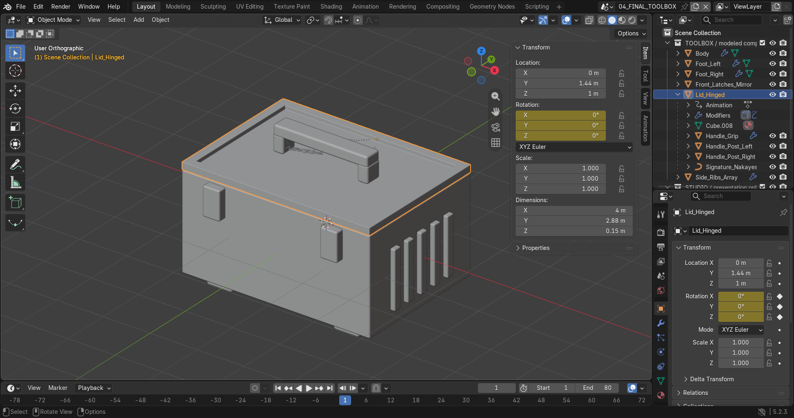
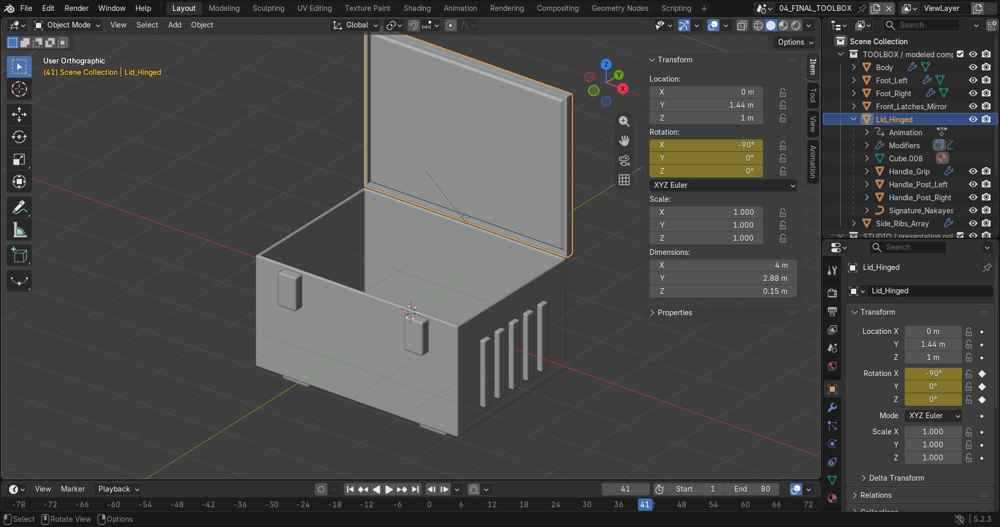

# Praktikum 9 — Hard-Surface Toolbox

Hajendra Herlambang — 5025241101

Muhammad Abdul Rafi — NRP: -

Praktikum ini membuat asset toolbox menggunakan Blender dari primitive cube, dengan operasi Extrude, Inset, loop horizontal, dan Bevel. Detail pengunci simetris menggunakan Mirror, rib samping menggunakan Array, dan ketebalan panel menggunakan Solidify sebagai tiga challenge. Geometry, scale, dan normal diperiksa, lalu komponen diberi nama dan disusun pada Outliner. File Blender dan screenshot tersedia di folder ini; screenshot perkembangan modeling merupakan rekonstruksi tahapan yang dikerjakan ulang dari asset awal.

**1. Primitive dan blockout**

Cube disusun menjadi badan, tutup, handle, dan tiang untuk menentukan bentuk utama toolbox.

**2. Extrude dan Inset**

Face atas di-inset untuk membuat rim, lalu diextrude ke dalam untuk membentuk rongga toolbox.

**3. Loop horizontal dan Bevel**

Loop horizontal membagi bidang badan, sedangkan Bevel membulatkan tepi agar tidak terlalu tajam.

**4. Mirror — pengunci simetris**

Satu pengunci dicerminkan pada sumbu X untuk menghasilkan pasangan pengunci depan.

**5. Array — detail berulang**

Satu rib diulang menjadi lima rib pada sisi toolbox menggunakan Array.

**6. Solidify — ketebalan panel**

Solidify memberi ketebalan pada badan dan tutup, lalu Bevel merapikan tepinya. Mirror, Array, dan Solidify menjadi tiga challenge yang dikerjakan.

**7. Topology cleanup**

Vertex duplikat, loose edge, dan face degenerat diperiksa. Scale seluruh mesh diterapkan menjadi 1.

**8. Pemeriksaan normal**

Face Orientation digunakan untuk memeriksa arah permukaan; warna biru menunjukkan sisi depan.

**9. Struktur objek**

Komponen diberi nama pada Outliner. Handle, tiang, dan tulisan menjadi child tutup agar mengikuti gerakannya.

**10. Animasi tutup**

Tutup tertutup pada frame 1, terbuka pada frame 41, lalu kembali tertutup pada frame 80.

**11. Hasil akhir**

Toolbox selesai dengan badan, tutup, handle, pengunci, rib, serta kaki, dan siap dilanjutkan ke UV dan material.

